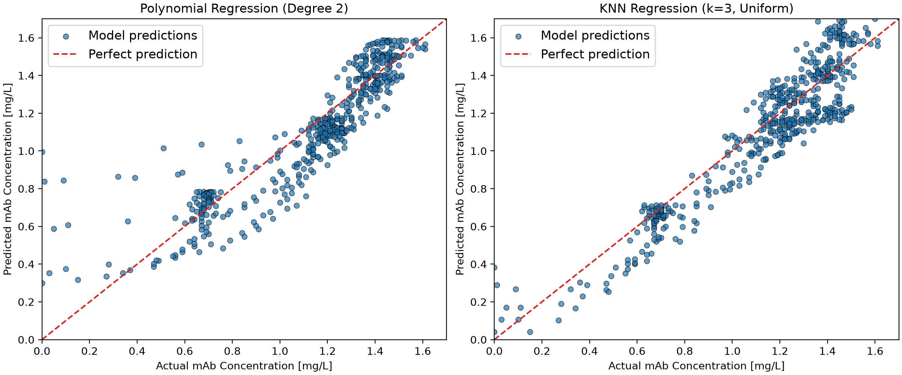

# Optimization of Monoclonal Antibody Production using Machine Learning
This project applies machine learning to predict monoclonal antibody (mAb) production and identify economically optimal 
operating conditions. Polynomial regression and k-nearest neighbors (kNN) regression models are trained using batch 
cultivation data, with initial glucose concentration, initial glutamine concentration, initial viable cell density, and 
harvest time as input variables. The trained models are then used to evaluate 29,155 possible operating conditions and 
maximize space-time profit while considering production costs, mAb value, and space-time yield. 

## Highlights
* Processed simulated batch cultivation data to train and evaluate machine learning models for monoclonal antibody 
production.
* Implemented polynomial regression and k-nearest neighbors (kNN) regression using scikit-learn pipelines.
* Used grid search and batch-aware cross-validation to optimize model hyperparameters.
* Evaluated 29,155 possible operating conditions to identify the combination that maximizes predicted space-time profit.
* Estimated approximate 95% prediction intervals for mAb concentration and related economic performance metrics.

## Environment
The following technology was used in this project:

* Python: 3.14.7
* NumPy: 2.5.2
* pandas: 3.0.5
* scikit-learn: 1.9.0
* SciPy: 1.18.0
* Matplotlib: 3.11.0

## Code Design
The program structure separates the main workflow, the machine learning models and the supporting functions into three 
Python files: `main.py`, `classes.py`, and `functions.py`. This reduces code repetition, allows individual components to 
be modified or reused without significantly changing the rest of the program and improves overall readability.

### main.py
The `main.py` file coordinates the overall workflow, from loading the simulated batch cultivation data to identifying 
economically optimal operating conditions.

The program starts by loading the selected batch datasets and their corresponding initial conditions. It then prepares 
the data by extracting the four input features and the target mAb concentration. The observations are divided into 
training and testing subsets at the batch level, to prevent measurements from the same batch from appearing in both.

Then, the program creates polynomial regression and k-nearest neighbors (KNN) regression objects. Each model undergoes 
hyperparameter optimization using grid search and group-based cross-validation before being evaluated on the unseen 
testing data. The code also generates actual-versus-predicted plots to visualize model performance.

Once the models have been evaluated, the program generates 29,155 possible combinations of operating conditions. Both 
trained models predict mAb concentrations for these conditions, and the corresponding economic parameters are calculated. 
The combination of conditions producing the highest predicted space-time profit is selected as the optimum for each model.

Finally, the program calculates approximate 95% prediction intervals using residual statistics, displays the optimal 
operating conditions, and exports the results to CSV files for further analysis.

### classes.py
The `classes.py` file defines two classes, MabProductionPolyModel and MabProductionKNNModel, which represent the 
polynomial and k-nearest neighbors regression models, respectively. Having each model within its own class keeps 
model-specific operations separate from the main workflow and makes it easier to compare the different models.

Both classes use scikit-learn pipelines that combine StandardScaler with their respective regression algorithms. 
Standardization ensures that input variables with different units and magnitudes are appropriately scaled before model 
fitting. The polynomial regression pipeline additionally uses PolynomialFeatures to capture non-linear relationships and 
interactions between input variables.

Each class implements methods for hyperparameter optimization, model evaluation, and prediction. 
The optimal_hyperparam() method uses GridSearchCV with three-fold GroupKFold cross-validation to identify optimal model 
parameters while keeping observations from the same cultivation batch together. The polynomial model evaluates different 
polynomial degrees, while the KNN model evaluates different numbers of neighbors. The evaluate_model() method assesses 
predictive performance using negative root mean squared error (RMSE), while predict_targets() generates mAb concentration 
predictions for new operating conditions. These methods provide a consistent interface for working with both models, 
which simplifies their use in main.py.

### functions.py
The `functions.py` file contains reusable functions that handle data preparation, economic calculations, optimization, 
uncertainty estimation, and visualization. Separating these operations from the main program reduces code repetition 
and makes individual functions easier to test and modify.

The data preparation functions, including load_batches(), load_initial_conditions(), and prep_training_data(), import 
the cultivation datasets and organize the observations into a structured format suitable for machine learning. This 
ensures that the models receive consistent input features and target values.

The generate_candidate_conditions() function creates all possible combinations of the specified glucose concentrations, 
glutamine concentrations, initial viable cell densities, and harvest times. Nested loops are used to generate 29,155 
possible operating conditions, which are stored in a pandas DataFrame for model predictions.

Economic performance is evaluated using calculate_production_economics() and evaluate_conditions(). The first function 
calculates culture cost, mAb value, profit, space-time profit, and space-time yield for a given operating condition and 
predicted mAb concentration. The second applies these calculations to every possible condition and organizes the results 
into a DataFrame. Keeping these calculations separate allows the same economic model to be applied consistently to pre
-dictions from both regression models.

The calculate_pred_interval() function estimates approximate 95% prediction intervals using the mean and standard de
-viation of prediction residuals and a critical value from Student's t-distribution. The resulting mAb concentration 
bounds are converted into corresponding economic bounds using the previously defined economic calculations.

Finally, the visualization functions generate actual-versus-predicted plots to compare model predictions with observed 
mAb concentrations. These figures, plus the exported CSV tables, support the interpretation and comparison of model 
performance.

Overall, this design separates data processing, machine learning, and economic analysis while keeping the main program 
organized and readable.

## Analysis
### Data selection and preparation
The dataset consists of simulated monoclonal antibody (mAb) production batches with varying initial operating conditions 
and measurements collected throughout cultivation. Rather than using all 1,029 available batches, 30 batches were 
selected to create a manageable dataset while maintaining variation in the operating conditions. Each selected batch 
contains 85 observations recorded at eight-hour intervals over 28 days, resulting in 2,550 observations.

Four input variables were used to predict mAb concentration: initial glucose concentration, initial glutamine concentra
-tion, initial viable cell density (VCD), and harvest time. Glucose and glutamine represent nutrients required for cell 
growth and antibody production, while VCD represents the initial cell population. Harvest time allows the models to 
account for changes in mAb concentration throughout cultivation.

The dataset was divided into training and testing subsets using an 80/20 split at the batch level, which corresponds to 
24 training batches and six testing batches. This approach ensures that observations from the same batch are not 
distributed across both datasets. Since measurements collected from a single cultivation batch are related, splitting 
individual observations randomly could introduce data leakage and lead to unreliable model performance estimates.

Batch identifiers were also used during hyperparameter optimization through three-fold GroupKFold cross-validation. This 
was done to maintain a separation between cultivation batches during model validation, providing a more realistic 
evaluation of the models' ability to predict mAb concentrations for batches not included in their training folds.

While selecting 30 batches reduced computational requirements, it also limited the range and diversity of operating 
conditions represented in the training data. As a result, predictions for combinations that were not well represented by 
the selected batches may be less reliable. Using a larger and more representative selection of batches would improve 
the models' ability to generalize across the full operating range.

### Model selection and performance
Polynomial and k-nearest neighbors (KNN) regression models were selected to compare two approaches to predict mAb 
concentration. Polynomial regression models the relationship between operating conditions and antibody production using 
a mathematical equation, while kNN estimates concentrations based on the values observed at similar operating conditions. 
Comparing these models allows us to investigate whether a continuous polynomial relationship or a local, distance-based 
approach better represents the simulated cultivation data.

As previously mentioned, both models were implemented using scikit-learn pipelines with StandardScaler to account for 
differences in the scales of the input variables. Without scaling, variables with larger magnitudes could dispropor
-tionately influence the distance calculations used by kNN.

Hyperparameters were optimized using GridSearchCV with three-fold GroupKFold cross-validation. For polynomial regression, 
degrees 1, 2, and 3 were evaluated, with degree 2 selected as the best-performing option. This indicates that including 
quadratic terms and interactions improved predictive performance compared with the other degrees considered. For kNN, 
different numbers of neighbors were evaluated, with three neighbors and uniform weighting selected as the optimal 
configuration.

Model performance was evaluated using negative root mean squared error (RMSE) on the six held-out testing batches. 
Polynomial regression achieved an RMSE of -0.148569 mg/L, while kNN achieved a higher RMSE of -0.129485 mg/L. This 
suggests that KNN provided more accurate predictions for the selected testing batches, although the difference does not 
necessarily establish that it would outperform polynomial regression on every possible cultivation batch. The actual
-versus-predicted plots in Figure 01 provided additional insight into model performance. 

Both models generally followed the ideal prediction line, indicating that they captured important relationships between 
the operating conditions and mAb concentration. However, polynomial regression showed noticeable overprediction for some 
observations with low actual mAb concentrations. The KNN predictions displayed a more clustered pattern, reflecting the 
model's reliance on averages of neighboring training observations.

Overall, KNN demonstrated better predictive accuracy on the testing data and was therefore the preferred model based on 
RMSE. Nevertheless, polynomial regression remains useful for comparison because it provides a representation of the 
relationships between operating conditions and mAb production. The limitations of both approaches, particularly when 
predicting operating conditions that are poorly represented in the training data, should be considered when interpreting 
the subsequent optimization results.

### Economic optimization
Following model evaluation, both regression models were used to predict mAb concentrations for 29,155 possible operating 
conditions. These combinations were generated by varying initial glucose concentration, initial glutamine concentration, 
initial viable cell density (VCD), and harvest time within their specified ranges. The objective was to identify the 
operating conditions that maximize space-time profit, rather than simply maximizing antibody concentration.

Space-time profit was selected as the optimization objective because it considers production revenue, culture costs, and 
process duration. Although higher mAb concentrations generally increase revenue, they do not necessarily result in 
greater profitability if they require more expensive cultivation conditions or longer production times. The economic 
calculations therefore included glucose, glutamine, and initial VCD costs, as well as a one-day downtime period between 
production batches.

The polynomial regression model identified an optimum of 20 mM glucose, 3 mM glutamine, 800,000 cells/mL initial VCD, 
and a harvest time of 3.67 days. Under these conditions, the predicted mAb concentration was 0.892805 mg/L, which led to 
a space-time profit of approximately $49.89/L/day and a space-time yield of 0.191315 mg/L/day. In comparison, the KNN 
model recommended 15 mM glucose, 3 mM glutamine, 800,000 cells/mL initial VCD, and a shorter harvest time of 2.67 days. 
Its predicted mAb concentration was 1.050000 mg/L, resulting in a space-time profit of $120.00/L/day and a space-time 
yield of 0.286364 mg/L/day.

Both models selected the same initial glutamine concentration and VCD, suggesting some agreement regarding favorable 
starting conditions. However, KNN recommended a lower glucose concentration and an earlier harvest. These differences 
reduced the predicted culture cost from $660/L to $610/L while increasing the predicted mAb value from approximately 
$892.81/L to $1,050/L. The shorter production cycle also contributed to the higher predicted space-time profit.

|Model     |Glucose [mM]|Glutamine [mM]|VCD [cells/mL]|Harvest time [days]|Predicted mAb [mg/L]|Space-time profit [$/L.day]|
|----------|------------|--------------|--------------|-------------------|--------------------|---------------------------|
|Polynomial|20.0        |3.0           |800000.0      |3.6666666666666665 |0.8928052534610311  |49.886840027363824         |
|kNN       |15.0        |3.0           |800000.0      |2.6666666666666665 |1.05                |120.0                      |

Overall, as seen in Table 01, KNN identified a more economically favorable operating condition within the evaluated 
possible conditions grid. However, it should be emphasized that these results represent model-based predictions, and not 
experimentally verified outcomes. Since the optimization includes operating conditions that may not be well represented 
in the selected training batches, the predicted economic advantages should be interpreted with caution. Experimental 
validation should be necessary before applying the recommended conditions in an actual production process.

### Prediction intervals and uncertainty
Approximate 95% prediction intervals were calculated to evaluate the uncertainty associated with the mAb concentrations 
predicted at the optimal operating conditions. These intervals were estimated using the mean and standard deviation of 
the residuals obtained from the testing dataset, together with a critical value from Student's t-distribution. The 
resulting concentration bounds were then converted into corresponding intervals for mAb value, space-time profit, and 
space-time yield using the economic equations.

For polynomial regression, the estimated mAb concentration interval was 0.630795–1.205878 mg/L, corresponding to a 
space-time profit interval of −$6.26 to $116.97/L/day and a space-time yield interval of 0.135170–0.258402 mg/L/day. The 
negative lower bound for space-time profit indicates that the predicted operating condition could result in an economic 
loss under the current cost and revenue model if mAb production is too low. For KNN regression, the estimated mAb 
concentration interval was 0.924171–1.418051 mg/L, corresponding to a space-time profit interval of $85.68–$220.38/L/day 
and a space-time yield interval of 0.252047–0.386741 mg/L/day. In this case, the lower space-time profit bound remained 
positive, suggesting a more favorable economic outcome under the estimated uncertainty range.

The corresponding mAb value intervals were approximately $630.79–$1,205.88/L for polynomial regression and 
$924.17–$1,418.05/L for KNN. These results illustrate how uncertainty in predicted mAb concentration directly affects 
the estimated economic performance of the process.

Overall, the calculated intervals support the selection of KNN as the more promising model for economic optimization, 
since it achieved a higher testing negative RMSE and predicted higher space-time profit. However, these intervals should 
be interpreted as approximate uncertainty estimates rather than statistically validated 95% coverage guarantees. In fact,
they are based on pooled testing residuals and do not fully account for correlations between observations from the same 
cultivation batch or uncertainty introduced by selecting the optimum from thousands of candidate conditions.

### Limitations and recommendations
Although the program successfully developed and compared two machine learning models for monoclonal antibody production, 
several limitations should be considered when interpreting the results.

First, as previously mentioned, only 30 of the 1,029 available cultivation batches were used for model development. 
Therefore, the selected batches may not adequately represent the full range of operating conditions. As a result, the 
models may produce less reliable predictions for combinations of glucose, glutamine, VCD, and harvest time that are 
poorly represented in the training data. Future improvements could include using a larger and more diverse selection of 
batches to ensure better coverage of the operating conditions.

Then, both regression models have limitations related to their underlying approaches. Polynomial regression assumes 
that the relationships between the input variables and mAb concentration can be approximated by a polynomial equation. 
While this allows the model to capture nonlinear trends, it may not accurately represent more complex biological behavior, 
particularly outside the training data range. Contrarily, KNN relies on neighboring observations and may produce similar 
predictions for different operating conditions. Its performance also depends on the distribution and density of the 
training data. 

Another limitation concerns the prediction interval methodology. The approximate 95% prediction intervals were calculated 
using residuals from the held-out testing batches. Since multiple observations originated from the same batch, these 
residuals are not necessarily independent. Furthermore, using the testing data to estimate prediction uncertainty 
reduces its independence as a final evaluation dataset. A future improvement would be to generate out-of-fold residuals 
using GroupKFold on the training batches, saving the testing batches exclusively for final model evaluation. 

Overall, the project demonstrates how machine learning can support bioprocess optimization by combining predictions of 
antibody production with economic performance calculations. Although KNN achieved better predictive accuracy and iden
-tified a more profitable operating condition in the current analysis, the reliability of these recommendations could be 
improved through expanded training data, more robust uncertainty estimation, and experimental validation.

