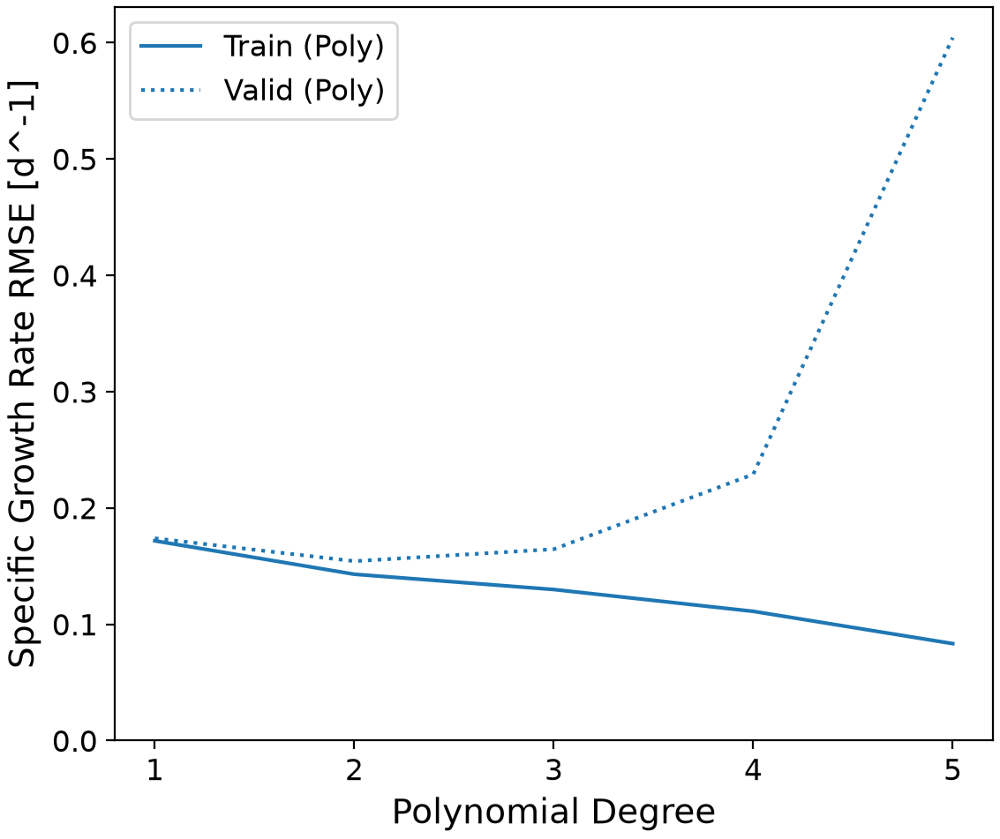
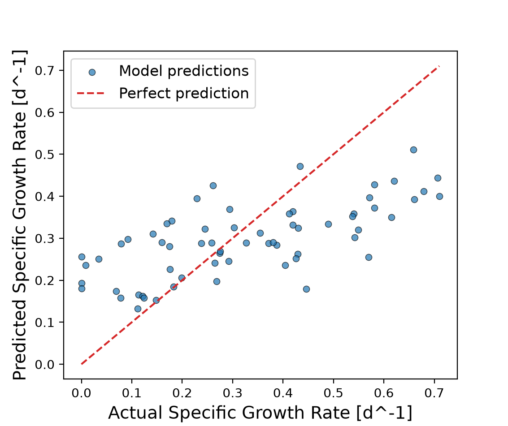
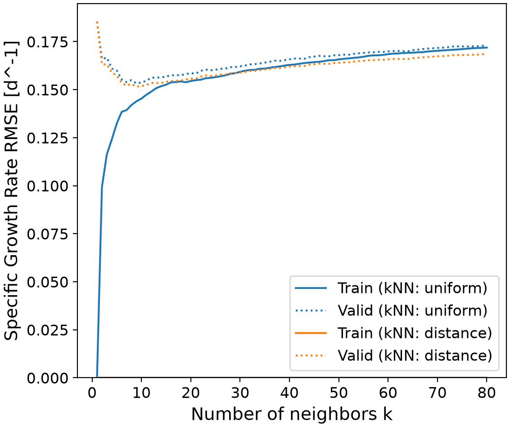
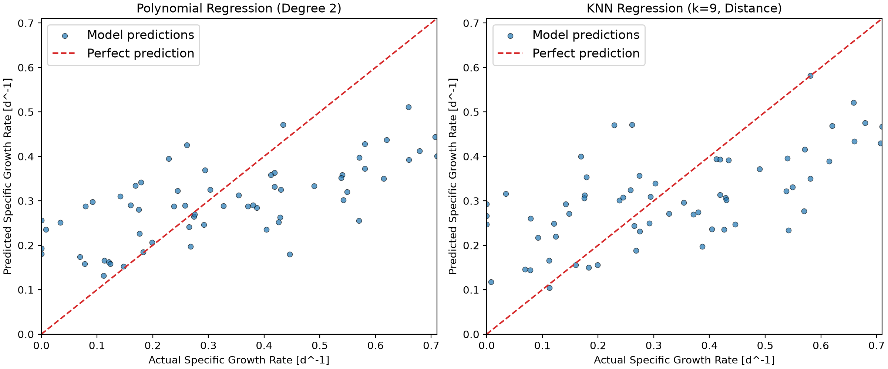
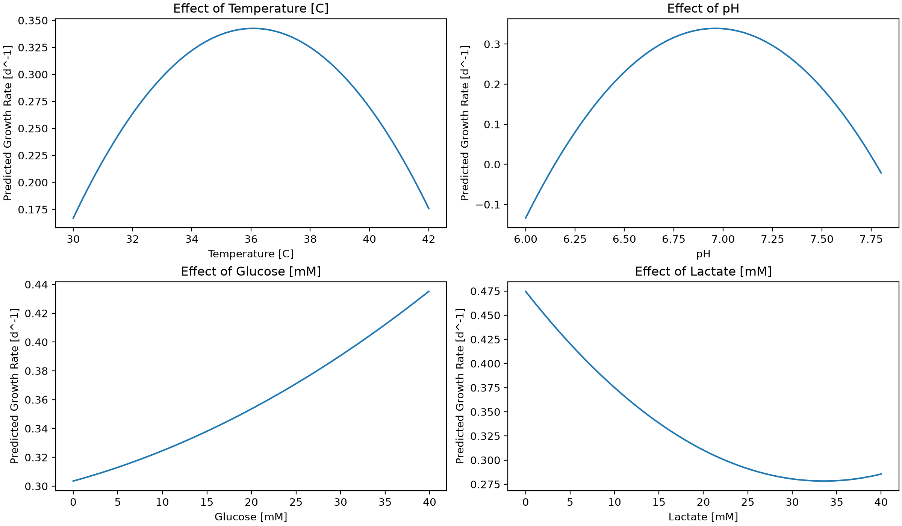

# Cell Growth Rate Prediction Using Machine Learning
This project develops a machine learning model that can predict the specific growth rate of cells based on four 
different cell culture variables: temperature, pH, glucose concentration and lactate concentration. Polynomial and 
k-nearest neighbors regressions are implemented and compared to determine a suitable predictive model. The selected 
model is then used to study the effects of each cell culture variable on cell growth, and its reliability is evaluated. 

## Highlights
* Developed polynomial and k-nearest neighbor regression models.
* Implemented feature standardization using pipelines.
* Optimized model hyperparameters using grid search cross-validation.
* Evaluated predictive model performance using root mean square error (RMSE).
* Visualized results using plots and tables.

## Environment
The following technology was used in this project:

* Python 3.14.7
* Matplotlib 3.11.0
* NumPy 2.5.2
* pandas 3.0.5
* scikit-learn 1.9.0

## Code Design
`main.py` can be divided into five sections

### Data loading and preparation
The code starts by loading the cell growth dataset [dataset_cell_growth_4factor.csv](https://github.com/cam0301/chg4360c-demo/blob/main/Predicting%20cell%20growth%20rates%20using%20Machine%20Learning/datasets/dataset_cell_growth_4factor.csv)
from a CSV file using the pandas library. It then separates the four input variables (temperature, pH, glucose 
concentration and lactate concentration) from the target variable (specific growth rate) before converting everything
into NumPy arrays. This makes them compatible with the scikit-learn library.

Following the grid search cross-validation workflow, the dataset is then divided into training and testing subsets using
the scikit-learn `train_test_spliy()` object: 80% of the data is allocated to the training subset and the remaining 
20% to testing. The training subset is used to engineer and optimize the models, keeping the testing subset for the
evaluation of their predictions on unseen data.

### Model engineering and preprocessing
Two regression models are implemented in their respective classes: polynomial regression and k-nearest neighbors (KNN) 
regression. Both use `make_pipeline()` from scikit-learn to simplify the workflow by combining the preprocessing 
and the regression into a single object. It also reduces the risk of mixing training and test data.

For the polynomial regression, the pipeline encapsulates `StandardScaler()`, `PolynomialFeatures()` and `LinearRegression()`
objects. The standardization scales the input variables, polynomial features generates the higher-order and interaction
terms and linear regression estimates the coefficients of said terms. The KNN regression pipeline also contains 
`StandardScaler()`, but is combined with `KNeighborsRegressor()`. 

### Hyperparameter optimization
With the pipelines defined, the program can identify appropriate hyperparameters for each model using scikit-learn's 
`GridSearchCV()`. The grid search was implemented because it evaluates different hyperparameter combinations to
determine which one provides the best predictive performance. This code uses a four-fold cross-validation: the training
data is divided into four subsets, each combination is trained and validated four times with a different subset used
for iteration. It is a more robust alternative to a single train-test split as evaluating model performance across 
multiple data partitions reduces the evaluation metric's dependence on any one split. 

For the polynomial regression, the `optimal_hyperparam()` function evaluates degrees one through five to identify the
appropriate level of model complexity. For the KNN regression, the same function tests both the uniform and the distance
-based methods, with the number of neighbors varying from 1 to 80. Both models are then evaluated using the RMSE, for 
which a score closer to zero indicates a better predictive performance.

The cross-validation results are stored into pandas DataFrames where they are sorted by validation score. This allows
the comparison of different combinations and the selection of the best hyperparameters.

### Predictive model evaluation and comparison
Following hyperparameter optimization, the program proceeds with the evaluation of the regression models using the 
testing subset, which remained unseen up to this point, as it was purposely excluded from model training and cross 
-validation. The now optimized polynomial and KNN models predict the specific growth rate of the cells using the four
input variables. The predictions are then compared with the actual growth rate from the dataset to observe the accuracy
of each model.

Evaluating the models using unseen data is important, to ensure that the model can generalize to new data. In fact, a
good predictive performance during training could simply be the result of the model being trained and optimized on the
training data. Comparing the model predictions on both the training and the testing data will help determine whether 
the model requires more or less complexity.

The root mean squared error (RMSE) was selected as the evaluation metric for the predictive performance of both models. 
It is the preferred evaluation metric as it can be used to evaluate any model, compared to the coefficient of determina
-tion (R^2^) which can only be used with linear models. When it comes to RMSE, a lower score indicates a better predic
-tion accuracy. Therefore, the program calculates the test RMSE for both models, to allow their comparison and the 
selection of the better suited model.

### Results visualization and export
To support the interpretation of the regression models, the program ends with generation of various figures and tables.
Matplotlib is used for the creation of the validation curves which illustrate the model performance depending on the
number of hyperparameters. These figures are used to determine the optimal mode configurations, and can reveal potential
overfitting or underfitting. Another type of figure generated by the program is a parity plot, or actual-vs-predicted
plot. These figures allow for a visual comparison between the growth rates predicted by both models and the actual 
growth rates from the dataset. They compliment the RMSE calculations by revealing patterns in prediction errors that 
may not be detectable from a single numeric value. The final type of figure is a sensitivity plot to study the influence
of the four input variables on the predicted growth rates. These will be further discussed in the analysis section.

All these figures are saved as PNG files in the figures directory and the relevant cross-validation results are exported
as CSV files in the tales directory.

## Analysis
### Initial model selection
Polynomial regression was initially selected to predict the specific cell growth rate based on the four input variables
because it can represent nonlinear relationships between the features and the target. In fact, while linear regression
assumes a linear relationship between the variables and the growth rate, polynomial regression introduces both higher
-order terms and interactions in between variables. This makes it better suited for cell culture processes as variations
in temperature, pH, glucose and lactate concentrations could have nonlinear effects on cell growth.

Therefore, a scikit-learn pipeline containing `StandardScaler()`, `PolynomialFeatures()` and `LinearRegression()` was
used to implement the model. `GridSearchCV()` was used to evaluate degrees ranging from 1 to 5 through four-fold cross
-validation and determine an appropriate polynomial degree. As previously mentioned, RMSE was selected as the evaluation
metric.

As shown in Figure 1, the lowest cross-validation RMSE score was achieved by the second-degree polynomial. Table 1 
presents the cross-validation results for the different polynomial degrees, confirming that the lowest RMSE score was
achieved by the second-degree model, with a RMSE of approximately 0.1542 d^-1^. 

|rank_test_score|param_polynomialfeatures__degree|mean_test_score     |
|---------------|--------------------------------|--------------------|
|1              |2                               |-0.1542291364059797 |
|2              |3                               |-0.16452155132164398|
|3              |1                               |-0.17387851917345115|
|4              |4                               |-0.2289139488940485 |
|5              |5                               |-0.6042549009766749 |

These results also shows that increasing the degree beyond two did not improve the validation performance, despite the 
added complexity. This suggests that additional complexity could increase the risk of overfitting. Therefore, second
-degree was selected as the optimal polynomial degree, as it provided a balance between model flexibility and predictive 
performance.

### Polynomial regression evaluation
Once the optimal degree selected, the model was evaluated using unseen data in the testing dataset. The second-degree
polynomial model achieved a test RMSE score of approximately 0.1579 d^-1^. The difference with the cross-validation RMSE,
0.1542 d^-1^, is quite small. This suggests that the model generalizes well enough to new data, as there is no substantial 
increase in prediction error.

Figure 2 is a parity plot comparing the model predicted specific growth rates to their actual values. If the model was
perfect, all the points (predicted values) would fall against the diagonal line (actual data). What the figure actually
shows is that there are noticeable deviations from the actual data line, particularly at the lower and at the higher
ends of the observed growth rates. It appears that the model tends to overpredict lower growth rates and underpredict
higher growth rates.

Despite the polynomial regression's ability to capture nonlinear relationships between the features and the target, 
these results prove that it does not completely represent the entirety of the variations in cellular growth. The reveal
of these limitations led to the investigation of the k-nearest neighbors regression as a suitable alternative to 
capture more patterns in the given data.

### K-nearest neighbors as an alternative
As previously mentioned, k-nearest neighbors (KNN) regression was investigated as an alternative to polynomial regression
after the latter's limitations were revealed. This study aims to determine whether a different modeling approach can
improve the predictive performance. 

While polynomial regression fits a global mathematical relationship between the input variables and the specific growth
rate, KNN model predictions are based on nearby observations within the training dataset. This allows this regression to
capture local patterns without assuming any specific mathematical relationship.

Similarly to the polynomial regression, a scikit-learn pipeline was used to implement the model. This one only contained
`StandardScaler()` and `KNeighborsRegressor()`. Standardization is particularly important for KNN regression since it
relies on distances between observations, which can be largely impacted by variables with larger numerical scales.
Hyperparameter optimization for KNN was also conducted using a four-fold cross-validation. As briefly mentioned above,
`GridSearchCV()` compared both the uniform and the distance-based weighting methods, with the number of neighbors varying
from 1 to 80. The same RMSE evaluation metric was selected to allow comparison with the polynomial regression. Figure 3
illustrates how the number of neighbors and the weighting method influence KNN regression prediction.

As shown in Table 2, the optimal hyperparameter configuration used distance-based weighting with 9 neighbors,
achieving a cross-validation RMSE of approximately 0.1515 d^-1^. These results show that when calculating predictions, 
distance weighting gives greater influence to closer observations. It is also observed that smaller neighbor counts will 
produce more complex predictions which are sensitive to individual observations, while larger neighbor counts might 
conceal important growth rate variations.

|rank_test_score|param_kneighborsregressor__n_neighbors|param_kneighborsregressor__weights|mean_test_score     |
|---------------|--------------------------------------|----------------------------------|--------------------|
|1              |9                                     |distance                          |-0.15154949304542978|
|2              |10                                    |distance                          |-0.15186947346546603|
|3              |7                                     |distance                          |-0.15213189290707774|
|4              |11                                    |distance                          |-0.15245092530927495|
|5              |8                                     |distance                          |-0.15296584277831374|
|6              |9                                     |uniform                           |-0.1532708586523278 |
|7              |6                                     |distance                          |-0.15347662163165898|
|8              |13                                    |distance                          |-0.15348143994813845|
|9              |12                                    |distance                          |-0.15350432139390674|
|10             |14                                    |distance                          |-0.15352914106891077|

The optimized KNN model was evaluated using the same metric, and it achieved a test RMSE of approximately 0.1587 d^-1^.
While the KNN regression had a slightly better predictive performance on the training data (0.1515 versus 0.1542), it 
had a slightly worse predictive performance with the testing data (0.1587 versus 0.1579). This suggests that the KNN 
regression provides a predictive performance comparable to the polynomial regression's, and that it isn't necessarily a
clear improvement over the latter.

### Model comparison and final selection
Let's recapitulate the latest results. The second-degree polynomial achieved a cross-validation RMSE of 0.1542 d^-1^ and
a test RMSE of 0.1579 d^-1^, while the KNN regression with 9 neighbors and distance-based weighting achieved a cross
-validation RMSE of 0.1515 d^-1^ and a test RMSE of 0.1587 d^-1^.

Despite KNN performing slightly better during cross-validation, polynomial regression performs slightly better during
testing. These marginal differences suggest that neither model presents a noticeable advantage in prediction accuracy.
To confirm these results, Figure 4 compares the actual data with the predicted growth rates for both models.

It shows that both approaches show similar prediction deviations at the extremes of the observed growth rate range. This
confirms that neither model completely captures the variations in cellular growth, and that neither model is necessarily
more accurate.

Ultimately, the second-degree polynomial regression was selected as the preferred model since it provides a comparable
predictive performance while offering a more interpretable mathematical structure. In fact, its polynomial terms can
represent the nonlinear relationships and interactions between the input variables, making it useful to study the in
-fluences of the cell culture conditions on the specific growth rate. Because KNN regression predictions depend on the
proximity of observations in the training dataset, it is more difficult to describe the various relationships with a 
single mathematical expression.

Thus, polynomial regression provides the sought-after balance between predictive performance, model complexity and 
interpretability.

### Influence of cell culture variables
The selected second-degree polynomial regression was used to study the effects of temperature, pH, glucose and lactate
concentrations on the predicted cellular specific growth rate. Figure 5 shows how each variable was varied individually
across its observed range while the other three variables were fixed at the mean value of their observed range.

Temperature exhibits a nonlinear relationship with predicted growth rate, reaching a maximum near 36°C before decreasing 
at higher temperatures. A similar trend is observed for pH, with the highest predicted growth rate occurring around a 
pH of 6.9. These results suggest that intermediate temperature and pH conditions are more favorable for cell growth 
compared to the extremes of their respective ranges.

Glucose concentration shows a positive linear relationship with predicted growth rate across the investigated range, 
with higher glucose concentrations corresponding to higher predictions. On the contrary, increasing lactate concentration 
mostly reduces predicted growth rate, although a slight increase is observed towards the end of the range. These trends 
suggest that glucose serves as a nutrient for cell growth while lactate accumulation could potentially lead to less 
favorable cell culture conditions.

Overall, Figure 5 demonstrates that the polynomial model was able to capture different relationships between the input 
variables and the predicted growth rate. However, these results represent **model predictions** and not experimentally 
established causal relationships. Due to the inclusion of interaction terms, the influence of one variable may also 
depend on the values of the others.

### High growth, low growth and unreliable conditions
Based on the analysis presented in the previous section, the polynomial regression model predicts higher specific growth 
rates at temperatures near 36°C and pH values around 6.9. Higher glucose concentrations and lower lactate concentrations 
are also associated with increased predicted growth rates. Together, these trends suggest that maintaining moderate 
temperature and pH conditions, sufficient glucose concentration, and minimal lactate accumulation should be favorable 
for cell growth.

On the other hand, lower predicted growth rates are associated with temperatures and pH values near the extremes of the 
investigated conditions. Lower glucose concentrations and higher lactate concentrations are also associated with lower 
predicted growth rates. 

However, all of these observations are based on changing one variable at a time, therefore, they do not establish which 
combination of input variables produces the highest or lowest growth rate.

As for the reliability of the model, predictions near the boundaries of the observed operating ranges may be less 
reliable due to the possibility of a lower number of representative observations being available in these regions. 
Similarly, combinations of temperature, pH, glucose, and lactate that are poorly represented in the training dataset 
could produce inaccurate predictions, even if the individual variable values fall within their observed ranges.
Additionally, the actual-versus-predicted results indicate that the model tends to overpredict low growth rates and 
underpredict high growth rates. Therefore, predictions under extreme or unusual operating conditions should be 
interpreted cautiously.

### Practical applications
The polynomial regression model developed in this program could be used as a preliminary tool to support cell culture 
analysis and process optimization. In fact, by predicting the specific growth rate from temperature, pH, glucose and 
lactate concentrations, this model could help researchers and bioprocess engineers evaluate different cellular environ
-mental conditions before conducting actual experiments. It could also support experimental planning by helping 
prioritize operating conditions that are expected to produce higher growth rates. 

These applications could help reduce the number of experimental conditions requiring initial investigation, which could 
save both time and resources. However, the model should be used as a decision-support tool rather than as a replacement 
for experimental measurements.

However, it should be noted that the model was developed using a relatively small dataset of 318 observations, which 
might not fully represent the range of possible cell culture conditions. Additionally, its predictions are based on only 
four input variables, while cell growth could also depend on other factors not included in this particular dataset. The 
model also shows poor predictive accuracy at the extremes of the observed growth-rate range and could therefore generate 
unreliable predictions for operating conditions that are poorly represented in the training data. These limitations 
would need to be considered and addressed before deciding to use it as a decision-support tool.

Overall, second-degree polynomial regression does provide a useful starting point for investigating cell growth behavior, 
by combining interpretable relationships with predictive performance comparable to the KNN regression.